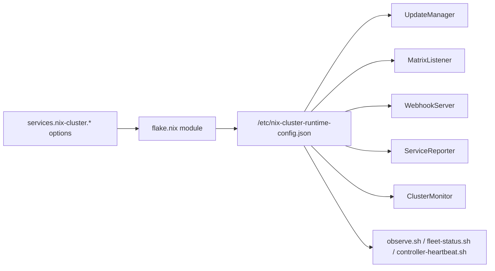
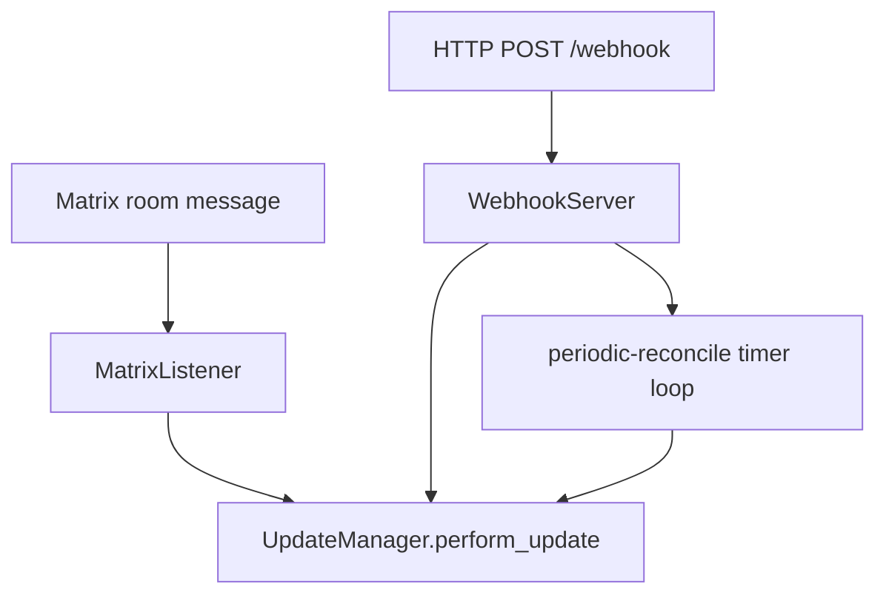
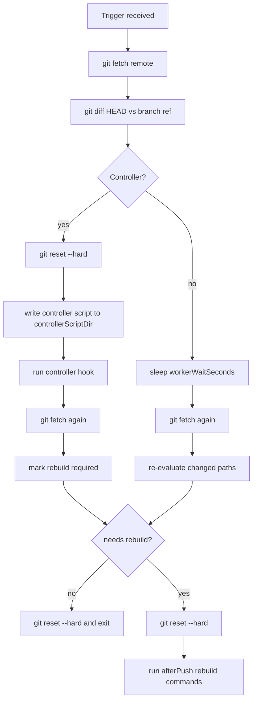
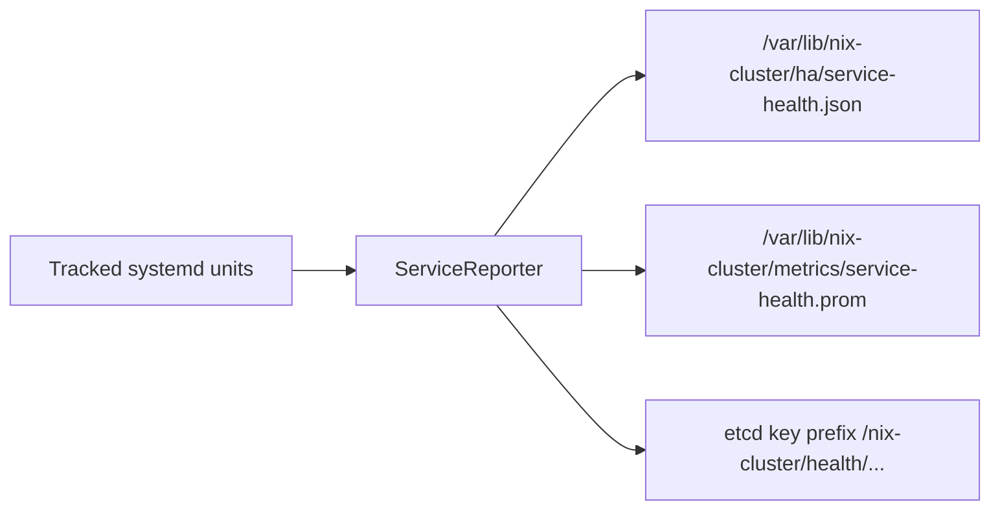
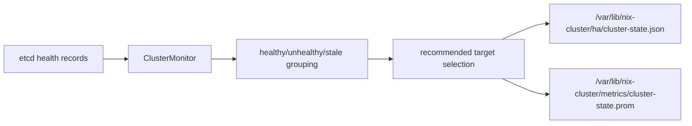
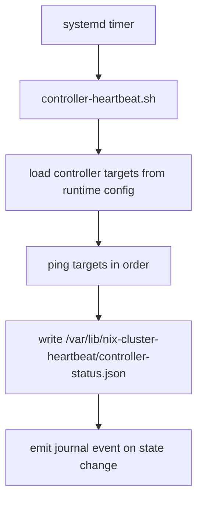
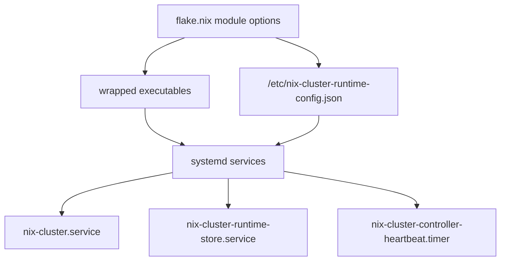
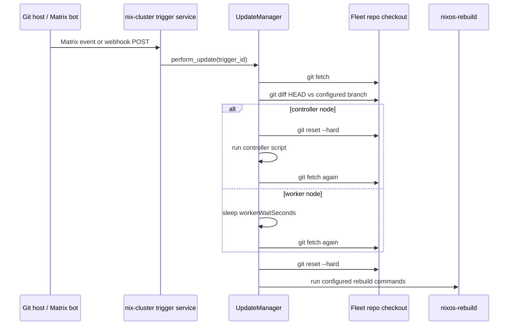
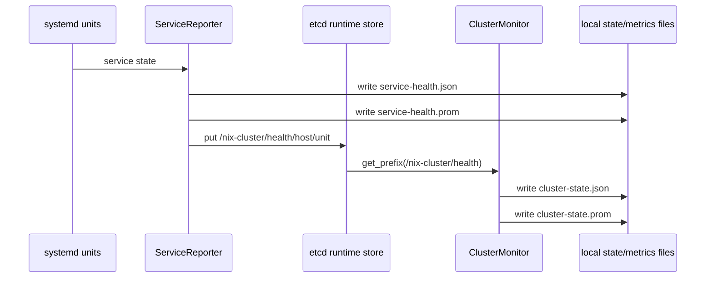
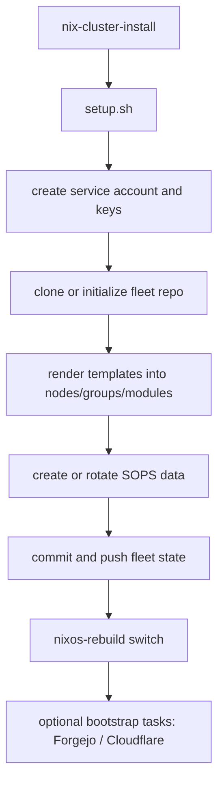

# nix-cluster Architecture and Data Flow

## Overview

`nix-cluster` is a GitOps control plane for a NixOS fleet.

At a high level it does four jobs:

1. Receives update triggers from Matrix messages or HTTP webhooks.
2. Decides whether a node should rebuild based on repo changes and node role.
3. Reports local service health and optionally aggregates fleet health through etcd.
4. Bootstraps and enrolls new nodes into the fleet repository.

The codebase is intentionally split into:

- Nix packaging and service/module wiring in [flake.nix](../flake.nix)
- Runtime Python services in [src/nix_cluster](../src/nix_cluster)
- Shell utilities and installer logic in [src](../src)
- Fleet scaffolding templates in [templates](../templates)

---

## Repository Layout

### Core runtime Python files

There are 8 Python files in the runtime package:

| File | Responsibility |
|---|---|
| [src/nix_cluster/__init__.py](../src/nix_cluster/__init__.py) | Package exports |
| [src/nix_cluster/config.py](../src/nix_cluster/config.py) | Typed runtime configuration model loaded from `/etc/nix-cluster-runtime-config.json` |
| [src/nix_cluster/core.py](../src/nix_cluster/core.py) | Shared logging, process execution, and atomic file writing utilities |
| [src/nix_cluster/runtime.py](../src/nix_cluster/runtime.py) | etcd client used for HA state publishing and aggregation |
| [src/nix_cluster/update.py](../src/nix_cluster/update.py) | `UpdateManager`, the git/rebuild decision engine |
| [src/nix_cluster/listener.py](../src/nix_cluster/listener.py) | Matrix-triggered update listener |
| [src/nix_cluster/webhook.py](../src/nix_cluster/webhook.py) | HTTP webhook-triggered update listener |
| [src/nix_cluster/ha.py](../src/nix_cluster/ha.py) | Service health reporter and controller-side HA monitor |

### Shell scripts

| Script | Role |
|---|---|
| [src/setup.sh](../src/setup.sh) | Main installer and enrollment workflow used by `nix-cluster-install` |
| [src/lib/install-config.sh](../src/lib/install-config.sh) | CLI/config parsing helper for `setup.sh` |
| [src/observe.sh](../src/observe.sh) | Local node observability CLI for service status and journals |
| [src/node-observe.sh](../src/node-observe.sh) | Remote wrapper that runs `nix-cluster-observe` on another node |
| [src/fleet-status.sh](../src/fleet-status.sh) | Fleet-wide status collection across nodes |
| [src/fleet-watch.sh](../src/fleet-watch.sh) | Repeated fleet polling and change display |
| [src/controller-heartbeat.sh](../src/controller-heartbeat.sh) | Worker-side controller reachability monitor |
| [src/deploy.sh](../src/deploy.sh) | Deprecated stub kept for compatibility |

---

## Runtime Model

The runtime is driven by a generated JSON file:

- `/etc/nix-cluster-runtime-config.json`

That file is produced by the NixOS module in [flake.nix](../flake.nix) and then consumed by the Python services and shell helpers.

### Runtime configuration flow

This design is important because the runtime behavior is not hardcoded into the daemons alone. It is declared through NixOS options, serialized once, and then reused consistently by all components.

---

## Main Runtime Components

## 1. Trigger listeners

`nix-cluster.service` starts a small runtime supervisor shell script generated by [flake.nix](../flake.nix). Depending on enabled options, it launches:

- Matrix listener: [src/nix_cluster/listener.py](../src/nix_cluster/listener.py)
- Webhook listener: [src/nix_cluster/webhook.py](../src/nix_cluster/webhook.py)
- HA reporter: [src/nix_cluster/ha.py](../src/nix_cluster/ha.py)
- HA monitor: [src/nix_cluster/ha.py](../src/nix_cluster/ha.py) on controllers only

### Trigger flow

### Matrix listener

The Matrix listener:

- connects to the configured homeserver
- syncs a configured room
- looks for configured trigger keywords
- forwards qualifying events into `UpdateManager`

Relevant file: [src/nix_cluster/listener.py](../src/nix_cluster/listener.py)

### Webhook listener

The webhook listener:

- exposes `POST /` and `POST /webhook`
- extracts a trigger id from the JSON payload
- ignores commits tagged with the configured skip marker
- can also run periodic controller reconciliation on controller nodes

Relevant file: [src/nix_cluster/webhook.py](../src/nix_cluster/webhook.py)

---

## 2. Update manager

`UpdateManager` is the core decision engine.

Relevant file: [src/nix_cluster/update.py](../src/nix_cluster/update.py)

It is responsible for:

- `git fetch`
- diffing the current checkout against the configured branch ref
- deciding whether the node should rebuild
- running controller hooks before rebuilds on controller nodes
- sleeping and re-fetching on workers so controller-generated changes can arrive first
- executing configured rebuild commands

### Update decision flow

### Rebuild policy

By default, a rebuild is triggered when changed files touch paths such as:

- `nodes/<hostname>/`
- `groups/`
- `modules/`
- `deployments.json`
- `secrets/`
- `scripts/`
- `flake.nix`
- `flake.lock`

Those defaults are now declared by service options and serialized into runtime config.

---

## 3. HA reporting and aggregation

The HA layer lives in [src/nix_cluster/ha.py](../src/nix_cluster/ha.py).

It contains two services:

- `ServiceReporter`: runs on any node where HA reporting is enabled
- `ClusterMonitor`: runs only on controller nodes where HA scheduler mode is enabled

### Reporter flow

The reporter:

- queries systemd unit state with `systemctl show`
- determines whether a service is healthy
- writes local JSON snapshots
- writes Prometheus textfile metrics
- optionally publishes service state into etcd

### Controller monitor flow

The controller monitor:

- reads all service health records from etcd
- groups reports per service
- marks stale reports
- computes a preferred healthy target per service
- writes aggregated local state and metrics

---

## 4. Worker heartbeat monitoring

Workers can run a timer-backed heartbeat monitor:

- service script: [src/controller-heartbeat.sh](../src/controller-heartbeat.sh)
- systemd service and timer wiring: [flake.nix](../flake.nix)

### Heartbeat flow

This script does not rebuild anything. It only records whether a worker can reach one of the configured controller targets.

---

## Shell Script Responsibilities

## Installer and enrollment scripts

### [src/setup.sh](../src/setup.sh)

This is the largest shell script because it owns installation and enrollment.

It handles:

- parsing interactive or JSON-driven install input
- creating the `nix-cluster` service account
- preparing Age/SOPS keys
- cloning or initializing the fleet repository
- scaffolding group and node configuration from templates
- configuring optional modules like Caddy, Keepalived, Cloudflare, PXE, and PostgreSQL backup
- updating `.sops.yaml`, `flake.nix`, `deployments.json`, and `secrets.yaml`
- triggering the first rebuild
- bootstrap-specific Forgejo and Cloudflare provisioning steps

In practice, `setup.sh` is the installer/state-machine for fleet enrollment.

### [src/lib/install-config.sh](../src/lib/install-config.sh)

This is a helper library sourced by `setup.sh`.

It provides:

- CLI argument parsing
- `--set`, `--enable`, and `--disable` overrides
- normalization of installer option names
- translation from CLI override keys into installer variables

It exists so `setup.sh` does not need to hold all override parsing inline.

### [src/deploy.sh](../src/deploy.sh)

This file is deprecated. It prints a compatibility message and exits.

It is not part of the active runtime path.

## Observability and fleet shell tools

### [src/observe.sh](../src/observe.sh)

`nix-cluster-observe` is a local inspection utility.

It supports:

- `status` for current unit state
- `journal` for journal access

It reads `observability.tracked_units` from runtime config when no explicit units are provided.

### [src/node-observe.sh](../src/node-observe.sh)

`nix-cluster-node` is a remote wrapper around `nix-cluster-observe`.

It:

- resolves target login behavior
- tries controller SSH key auth first
- falls back to deployment inventory credentials if needed
- executes `nix-cluster-observe` remotely through `sudo`

### [src/fleet-status.sh](../src/fleet-status.sh)

`nix-cluster-fleet-status` iterates the deployment inventory and collects node status using `nix-cluster-node`.

It:

- loads `deployments.json`
- decrypts it through SOPS when possible
- filters requested hosts if provided
- skips the local controller host
- returns either human output or JSON

### [src/fleet-watch.sh](../src/fleet-watch.sh)

`nix-cluster-fleet-watch` repeatedly runs `nix-cluster-fleet-status --json`, normalizes the output, and prints changes over time.

It is a polling watch utility, not a daemon.

---

## NixOS Module and Service Wiring

The module in [flake.nix](../flake.nix) does three major things.

## 1. Packages the tools

It produces wrapped executables such as:

- `nix-cluster-daemon`
- `nix-cluster-webhook`
- `nix-cluster-reporter`
- `nix-cluster-monitor`
- `nix-cluster-observe`
- `nix-cluster-node`
- `nix-cluster-fleet-status`
- `nix-cluster-fleet-watch`
- `nix-cluster-controller-heartbeat`
- `nix-cluster-install`

## 2. Declares NixOS options

The module exposes runtime behavior under `services."nix-cluster".*`.

That includes:

- trigger configuration
- update behavior
- file paths
- HA runtime store behavior
- observability behavior
- module-specific knobs for ingress, Cloudflare, PXE, and backups

## 3. Builds the systemd services

It creates:

- `nix-cluster.service`
- `nix-cluster-runtime-store.service` when local etcd is enabled
- `nix-cluster-controller-heartbeat.service`
- `nix-cluster-controller-heartbeat.timer`
- optional Promtail and node exporter integration

### Service composition flow

---

## End-to-End Data Flow

## A. Normal GitOps update flow

## B. HA health reporting flow

## C. Enrollment flow

---

## Operational Summary

If you want the shortest mental model, it is this:

- `flake.nix` declares behavior.
- That behavior becomes `/etc/nix-cluster-runtime-config.json`.
- Matrix and webhook listeners call `UpdateManager`.
- `UpdateManager` decides whether to rebuild.
- `ha.py` publishes and aggregates service health.
- Shell scripts provide installer, observability, and remote fleet tooling.

---

## Quick Script Reference

| Command | Backing script | Purpose |
|---|---|---|
| `nix-cluster-install` | [src/setup.sh](../src/setup.sh) | Enroll or bootstrap a node |
| `nix-cluster-observe` | [src/observe.sh](../src/observe.sh) | Inspect local node service state |
| `nix-cluster-node` | [src/node-observe.sh](../src/node-observe.sh) | Inspect another node remotely |
| `nix-cluster-fleet-status` | [src/fleet-status.sh](../src/fleet-status.sh) | Summarize remote node status across fleet |
| `nix-cluster-fleet-watch` | [src/fleet-watch.sh](../src/fleet-watch.sh) | Poll and display changes in fleet status |
| `nix-cluster-controller-heartbeat` | [src/controller-heartbeat.sh](../src/controller-heartbeat.sh) | Record controller reachability from workers |

---

## Notes and Caveats

- `setup.sh` is intentionally large because it is both installer and bootstrap orchestrator.
- `deploy.sh` is deprecated and not part of the active architecture.
- The runtime is now compact on the Python side, but the shell side still includes both runtime utilities and installer workflows.
- Most behavior is option-driven through `services."nix-cluster".*`, not hidden in arbitrary constants.
