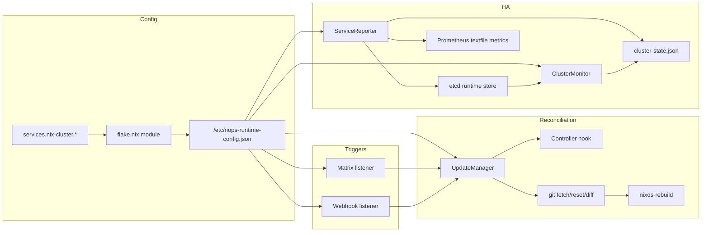
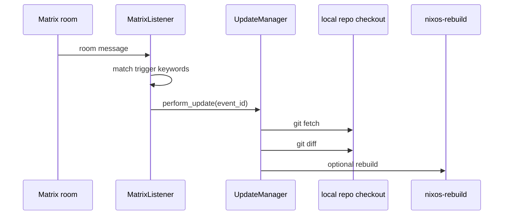
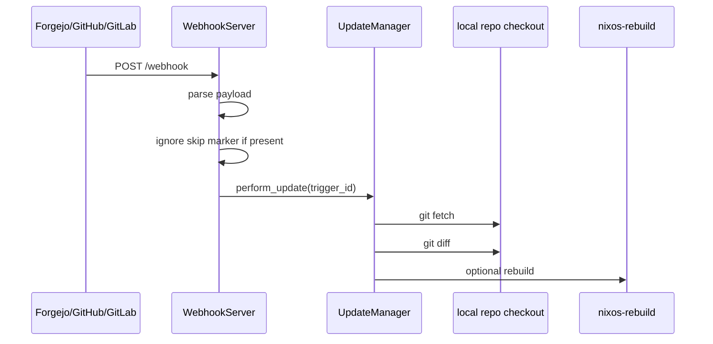
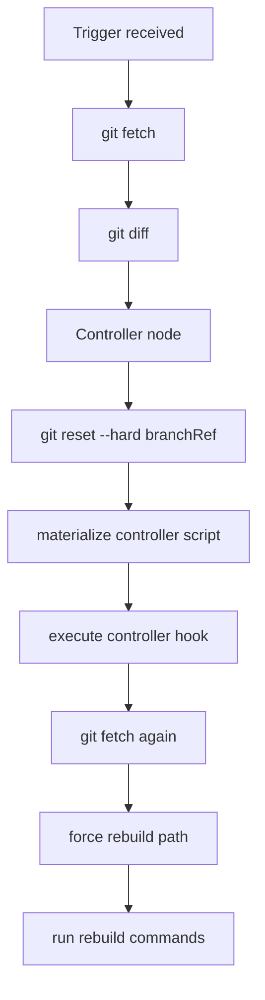
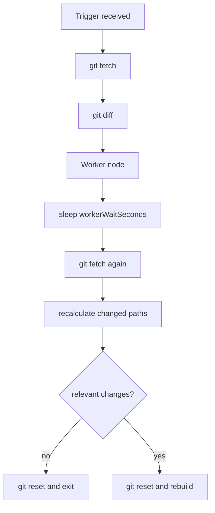
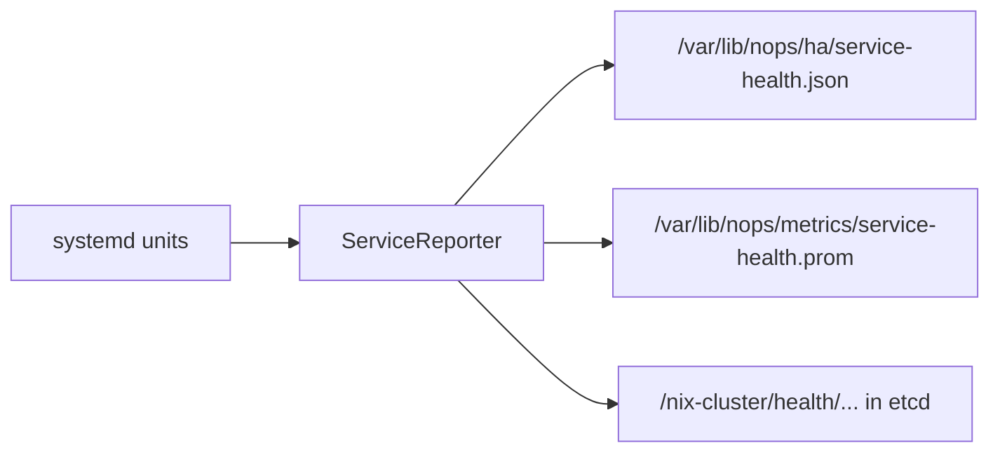
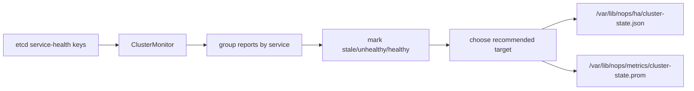
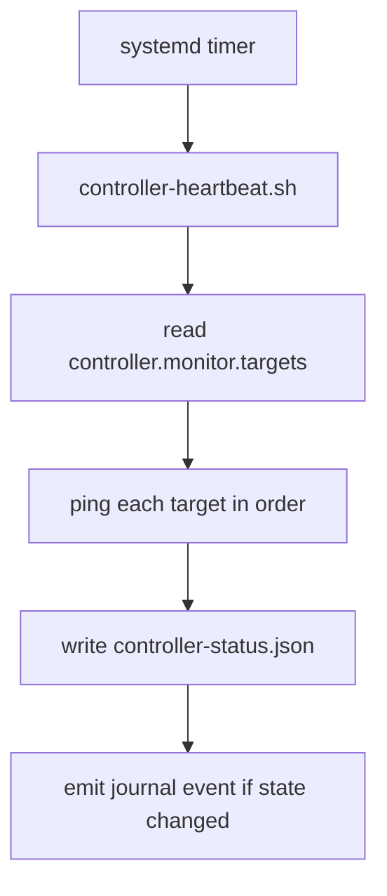
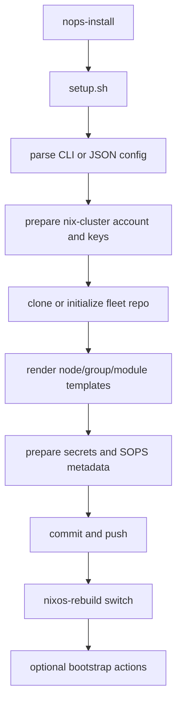

# Architecture and Data Flow

## Overview

`nix-cluster` has four primary runtime responsibilities:

1. Receive update triggers.
2. Decide whether a node should rebuild.
3. Report and aggregate service health.
4. Bootstrap and enroll nodes.

The runtime is driven from NixOS module options, not ad hoc environment assumptions.

---

## High-level architecture

---

## Configuration pipeline

### Step 1: options are declared in Nix

The NixOS module in `flake.nix` exposes `services."nix-cluster".*` options.

These options define:

- controller behavior
- trigger behavior
- update behavior
- HA behavior
- observability behavior
- module toggles
- file paths

### Step 2: options are serialized

The module writes a normalized runtime JSON file at:

- `/etc/nops-runtime-config.json`

This file becomes the operational contract between Nix and the runtime.

### Step 3: services consume the JSON

The Python services and several shell tools read the same runtime config file.

That gives consistent runtime behavior across:

- listeners
- update manager
- health reporting
- fleet status tools
- heartbeat checks

---

## Trigger architecture

## Matrix path

The Matrix listener:

- connects to the configured homeserver
- watches a specific room
- checks message text for trigger keywords
- forwards qualifying events to the updater

## Webhook path

The webhook listener also supports periodic controller reconciliation on controller nodes.

---

## Update manager behavior

`UpdateManager` is the reconciliation engine.

It is responsible for:

- fetching from the configured remote
- diffing against the configured branch ref
- deciding whether a rebuild is required
- running the controller script on controller nodes
- waiting for controller-generated changes on workers
- executing the configured rebuild commands

### Controller path

### Worker path

### Rebuild scope

By default, relevant path prefixes include:

- `nodes/<hostname>/`
- `groups/`
- `modules/`
- `deployments.json`
- `secrets/`
- `scripts/`
- `flake.nix`
- `flake.lock`

This keeps workers from rebuilding on changes that do not affect them.

---

## HA and observability architecture

## ServiceReporter

`ServiceReporter` runs locally and samples service health.

It:

- queries `systemctl show`
- computes a health boolean
- writes local JSON snapshots
- writes Prometheus textfile metrics
- optionally publishes health state into etcd

### Reporter data flow

## ClusterMonitor

`ClusterMonitor` runs on controllers and aggregates etcd reports.

It:

- reads all reported service health entries
- marks reports healthy, unhealthy, or stale
- selects a recommended target per service
- writes aggregated local cluster state
- writes cluster metrics

### Aggregation flow

---

## Worker heartbeat path

Workers can optionally run a heartbeat timer that checks controller reachability.

This is reachability tracking only. It is not a failover engine and it does not directly trigger rebuilds.

---

## Installer and enrollment architecture

The installer path is centered on `setup.sh`.

It performs:

- install-time config parsing
- service account preparation
- repo clone/bootstrap
- template rendering
- SOPS setup
- fleet structure creation
- first rebuild
- optional bootstrap actions like Forgejo and Cloudflare provisioning

### Enrollment flow

---

## Shell tooling map

| Tool | Purpose |
|---|---|
| `nops-install` | Bootstrap or enroll a node |
| `nops-observe` | Inspect local service state and journals |
| `nops-node` | Run observability commands on remote nodes |
| `nops-fleet-status` | Collect fleet-wide node state |
| `nops-fleet-watch` | Poll fleet state and display changes |
| `nops-controller-heartbeat` | Record worker->controller reachability |

---

## Packaging model

The flake builds wrapped executables for:

- listeners
- HA helpers
- shell tools
- installer tooling

This means runtime dependencies are injected by package wrappers rather than relying on ambient PATH state.

---

## Design principles

`nix-cluster` follows a few core principles:

- declarative runtime options
- controller/worker role separation
- shared normalized runtime config
- small Python runtime surface
- shell reserved for installer and ops tooling
- Git-driven desired state
- SOPS-managed secrets

---

## Next page

Continue with [Configuration Reference](Configuration-Reference.md).
