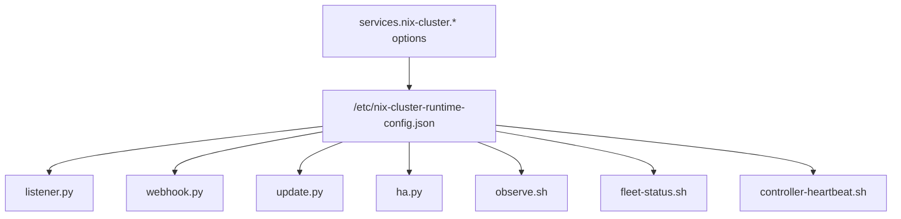

# Configuration Reference

## Overview

All primary runtime behavior is exposed through `services."nix-cluster".*` options in the NixOS module.

Those values are serialized into `/etc/nix-cluster-runtime-config.json` and consumed by the runtime.

---

## Top-level service options

### `services."nix-cluster".enable`

Enables the package, runtime config generation, systemd units, tmpfiles, and related integration.

### `services."nix-cluster".isController`

Marks the node as a controller.

Controllers may:

- run `controllerScript`
- perform controller reconciliation
- run HA aggregation
- own local runtime-store responsibilities

### `services."nix-cluster".controllerScript`

Bash script executed only on controller nodes before the rebuild path continues.

This is where fleet-level orchestration belongs, for example:

- provisioning
- inventory publishing
- generating controller-driven state
- updating secrets or metadata in Git

### `services."nix-cluster".repoPath`

Local fleet checkout path used by the updater.

### `services."nix-cluster".afterPush`

List of shell commands executed when a rebuild is required.

In most deployments this includes `nixos-rebuild switch --flake ...`.

---

## Path options

These control where runtime state is written.

### `services."nix-cluster".paths.logDir`

Log directory used by runtime services.

### `services."nix-cluster".paths.stateDir`

Base directory for HA state and runtime snapshots.

### `services."nix-cluster".paths.metricsDir`

Prometheus textfile metrics directory.

### `services."nix-cluster".paths.heartbeatStateDir`

State directory for worker heartbeat output.

### `services."nix-cluster".paths.runtimeConfigPath`

Path under `/etc` where the runtime JSON is generated.

### `services."nix-cluster".paths.controllerScriptDir`

Directory where the controller hook is materialized before execution.

---

## Update options

### `services."nix-cluster".update.remoteName`

Git remote used by the updater.

Default behavior typically uses `origin`.

### `services."nix-cluster".update.branchRef`

Branch ref used for diff and reset operations.

Typical value:

- `origin/main`

### `services."nix-cluster".update.relevantPaths`

List of repo path prefixes that should trigger a rebuild for the current node.

### `services."nix-cluster".update.workerWaitSeconds`

How long workers wait before re-fetching so controller-generated changes can land first.

---

## Controller options

### `services."nix-cluster".controller.reconcileIntervalSeconds`

Periodic reconciliation interval used by controllers when webhook periodic reconcile is enabled.

### `services."nix-cluster".controller.monitor.enable`

Enables worker-side controller reachability checks.

### `services."nix-cluster".controller.monitor.intervalSeconds`

Interval for the worker heartbeat timer.

### `services."nix-cluster".controller.monitor.targets`

Ordered list of controller IPs or hostnames that workers will probe.

---

## Trigger options

## Matrix

### `services."nix-cluster".matrix.enable`

Enables the Matrix listener.

### `services."nix-cluster".matrix.triggerKeywords`

Case-insensitive message fragments that trigger updates.

## Webhook

### `services."nix-cluster".webhook.enable`

Enables the HTTP webhook listener.

### `services."nix-cluster".webhook.bindAddress`

Bind address for the webhook server.

### `services."nix-cluster".webhook.port`

Port for the webhook server.

### `services."nix-cluster".webhook.sslCert`

Optional certificate path.

### `services."nix-cluster".webhook.sslKey`

Optional key path.

### `services."nix-cluster".webhook.skipCommitMarker`

Commit-message marker used to suppress webhook-triggered reconcile loops.

---

## Observability options

### `services."nix-cluster".observability.extraTrackedUnits`

Additional systemd units included in observability output.

### `services."nix-cluster".observability.prometheus.enable`

Enables Prometheus node exporter integration with textfile metrics.

### `services."nix-cluster".observability.prometheus.port`

Node exporter port.

### `services."nix-cluster".observability.loki.enable`

Enables Promtail integration.

### `services."nix-cluster".observability.loki.url`

Loki push endpoint.

---

## HA options

### `services."nix-cluster".ha.enable`

Master switch for HA reporting and scheduling behavior.

## Reporting

### `services."nix-cluster".ha.reporting.enable`

Enables local service health reporting.

### `services."nix-cluster".ha.reporting.mode`

Controls service inclusion logic.

### `services."nix-cluster".ha.reporting.services`

Explicit service list used by reporting filter logic.

### `services."nix-cluster".ha.reporting.includeTrackedUnits`

Whether tracked observability units are automatically included.

### `services."nix-cluster".ha.reporting.intervalSeconds`

Reporter loop interval.

## Runtime store

### `services."nix-cluster".ha.runtimeStore.type`

Runtime store backend type.

Currently intended for etcd-backed HA state.

### `services."nix-cluster".ha.runtimeStore.endpoint`

Endpoint used by reporters and monitors.

### `services."nix-cluster".ha.runtimeStore.keyPrefix`

Prefix for service health entries.

### `services."nix-cluster".ha.runtimeStore.inventoryPrefix`

Prefix for controller-published node inventory records.

### `services."nix-cluster".ha.runtimeStore.joinPrefix`

Prefix for controller-published join and provisioning state.

### `services."nix-cluster".ha.runtimeStore.staleAfterSeconds`

Maximum age before a report is treated as stale.

## Local runtime store

### `services."nix-cluster".ha.runtimeStore.localServer.enable`

Enables a local etcd instance on the node.

### `services."nix-cluster".ha.runtimeStore.localServer.*`

Controls local etcd member name, client URLs, peer URLs, initial cluster data, and cluster state.

## Scheduler

### `services."nix-cluster".ha.scheduler.enable`

Enables controller-side HA aggregation.

### `services."nix-cluster".ha.scheduler.intervalSeconds`

Aggregation interval.

---

## Module toggles

The module surface also carries service toggles used by fleet composition.

Examples include:

- `modules.caddy.enable`
- `modules.keepalived.*`
- `modules.cloudflare.*`
- `modules.pxe.*`
- `modules.postgresBackup.enable`

These are used both for runtime tracking and for the installer/scaffolding model.

---

## Runtime configuration consumers

---

## Practical guidance

Use NixOS options for runtime behavior when:

- the setting affects update logic
- the setting affects controller or worker behavior
- the setting affects file paths
- the setting affects HA or observability
- the setting needs to stay stable across rebuilds

Avoid pushing operational behavior into hardcoded Python constants when it belongs in the declarative service surface.

---

## Next page

Continue with [Operations and Enrollment](Operations-and-Enrollment.md).
