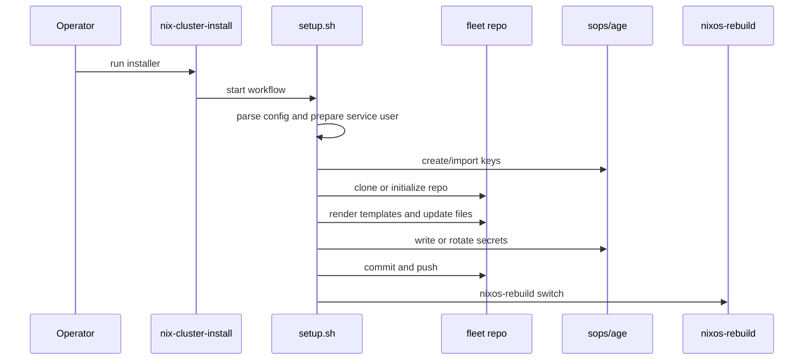
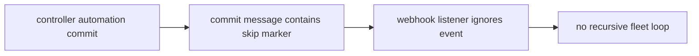

# Operations and Enrollment

## Overview

`nix-cluster` includes both runtime services and operator-facing shell tooling.

This page explains what each operational script does and how the installer/enrollment path works.

---

## Operational shell commands

## `nix-cluster-observe`

Backing script:

- `src/scripts/observe.sh`

Purpose:

- local node inspection
- service state display
- journal inspection

Capabilities:

- `status [--json] [unit ...]`
- `journal [journalctl flags]`

If no units are provided, it uses tracked units from runtime config.

## `nix-cluster-node`

Backing script:

- `src/scripts/node-observe.sh`

Purpose:

- run `nix-cluster-observe` remotely on another node

Behavior:

- tries controller SSH key auth first
- can consult deployment inventory for fallback credentials
- executes the remote command through `sudo`

## `nix-cluster-fleet-status`

Backing script:

- `src/scripts/fleet-status.sh`

Purpose:

- poll multiple nodes and summarize their service state

Behavior:

- reads `deployments.json`
- decrypts with SOPS if possible
- iterates remote nodes
- emits human-readable or JSON output

## `nix-cluster-fleet-watch`

Backing script:

- `src/scripts/fleet-watch.sh`

Purpose:

- repeated polling of fleet state
- printing changes over time

It is a watch tool, not a daemon.

## `nix-cluster-controller-heartbeat`

Backing script:

- `src/scripts/controller-heartbeat.sh`

Purpose:

- worker-side reachability tracking for controller targets

Behavior:

- loads configured controller targets
- pings them in order
- writes JSON state
- emits a journal event when reachability changes

## Installer model

The installer entrypoint is:

- `nix-cluster-install`

Backed by:

- `src/setup.sh`
- `src/lib/install-config.sh`

### Installer responsibilities

The installer is responsible for:

- parsing interactive input or JSON config
- preparing the `nix-cluster` service user and directories
- preparing SOPS/Age keys
- cloning or bootstrapping the fleet repository
- rendering group, node, and module templates
- updating `flake.nix` and `.sops.yaml`
- writing and encrypting secrets
- running the first rebuild
- optionally performing bootstrap integrations

### Installer helper responsibilities

`install-config.sh` exists to keep installer override parsing manageable.

It provides:

- normalized override key handling
- `--set`, `--enable`, `--disable` support
- mapping of CLI override names into installer variables

---

## Enrollment flow

---

## Controller-led enrollment model

A controller can automate additional node enrollment through the private fleet repository inventory.

Typical high-level flow:

1. operator adds an inventory entry in the private fleet repo
2. controller sees the new desired state
3. controller reaches the live installer
4. controller installs the base system
5. controller runs the installer remotely
6. controller pushes the generated node state
7. the node rebuilds into fleet state

That controller-driven inventory belongs in the private fleet repo, not in the public `nix-cluster` repo.

## Worker installer strategy

Worker install behavior is configurable per worker through `services."nix-cluster".workers.<hostname>`:

- `installerMode = "default"`: run the built-in `nixos-install` command path.
- `installerMode = "replace"`: skip default installer and run `installerScript` only.
- `installerMode = "hooks"`: run `installerPreScript`, then default installer, then `installerPostScript`.

Defaults are backward-compatible and stay on `default` unless explicitly changed.

Custom script phases run on the live installer as root through the same SSH/auth path used for default provisioning. The controller captures failure artifacts and emits join-state phases so operators can watch progress in real time.

---

## Trigger loop prevention

Webhook-triggered updates must avoid infinite loops caused by controller automation committing back to Git.

That is why `nix-cluster` supports a configurable skip marker.

Typical behavior:

---

## Public vs private documentation guidance

Document in the public repo:

- how the installer works
- how runtime services are wired
- how options behave
- how HA reporting works
- how observability tools work

Document in the private fleet repo:

- specific hostnames and IPs
- secrets locations and policy
- migration plans
- rollout order
- production caveats
- service placement decisions

---

## Operational best practices

- keep runtime behavior option-driven through the NixOS module
- keep secrets in SOPS-managed files only
- let controllers own controller-only orchestration
- keep worker logic selective and conservative
- document fleet-specific rollout steps in the private repo
- treat installer automation as part of the GitOps workflow, not a separate manual system

---

## Suggested wiki reading order

1. `Home`
2. `Architecture and Data Flow`
3. `Configuration Reference`
4. `Operations and Enrollment`
